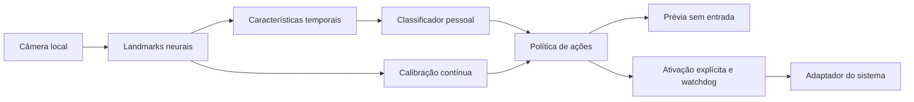

# Arquitetura

[Índice](README.md) · [Desenvolvimento](DEVELOPMENT.md) · [Validação](VALIDATION.md)

## Responsabilidades do aprendizado

O projeto usa três componentes com objetivos distintos:

| Componente | Método | Dados e finalidade |
| --- | --- | --- |
| Extração de landmarks | MediaPipe Hand Landmarker, redes neurais pré-treinadas | Localizar pontos da mão em frames locais; requer um `.task` externo licenciado |
| Classificação de gestos | Regressão logística ou Gaussian Naive Bayes, com scikit-learn | Aprender classes pessoais a partir de exemplos rotulados de pose e movimento |
| Calibração do cursor | Regressão ridge contínua | Relacionar o alcance do indicador às coordenadas normalizadas do monitor |

Ações não são selecionadas por uma coleção de limiares de distância entre dedos.
Distâncias, ângulos e movimento são características fornecidas ao classificador aprendido.
Limiares de confiança, margem e tempo guardam a execução depois da classificação.

## Fluxo de execução

Captura/inferência ficam em uma thread com um slot para o frame mais recente. A interface
consome esse slot; uma fila de comandos limitada alimenta um processo separado que possui
os botões pressionados pelo aplicativo. O processo rejeita comandos antigos e libera
botões quando os heartbeats param. O diagrama representa o desenho do software, não um
teste físico de câmera ou de entrada.

## Sessões, features e treinamento

Uma sessão é a unidade indivisível de treino ou avaliação. A separação por sessão/pessoa
acontece **antes** de gerar janelas sobrepostas; o escalonamento usa somente o conjunto
de treino. A escolha do classificador é explícita antes de examinar a comparação.

As janelas de 0,6 s produzem um vetor de 399 características: cinco amostras interpoladas
no tempo com coordenadas relativas ao punho/escala da palma, cossenos articulares e
distâncias, além de deslocamento e estatísticas de velocidade do punho. A mão esquerda
é canonicalizada no eixo x da pose. Janelas curtas, lacunas e trocas de mão são rejeitadas.

O [guia de treinamento](LEARNING.md) descreve rótulos, negativos, métricas e o risco de
reutilizar o conjunto reservado para ajustes repetidos.

## Política de entrada

O controle inicia pausado/desarmado. A política exige confiança/margem suficientes,
estabilidade temporal e `neutral` para rearmar episódios discretos. Rejeições e tracking
inválido não geram novos comandos; um arraste mantido pode ser liberado por segurança.

Frames incluem o horário de início da captura/inferência. O orçamento de idade é 250 ms;
o watchdog do processo reage após 350 ms sem comandos recentes. Pausar incrementa uma
geração compartilhada, invalidando comandos da ativação anterior. Esses valores não
comprovam a latência do sensor/driver, que precisa ser medida em hardware.

O worker é não-daemon, mantém posse de liberações que falharam e confirma a limpeza.
O fechamento da janela pode ficar pendente até essa confirmação e a conclusão do worker.
Não há término forçado por timeout. Falhas do sistema, morte forçada do processo ou uma
permissão que impeça a liberação continuam sendo limites operacionais.

Prévia, replay e avaliação usam `Runtime`/`Policy`; replay preserva as liberações de
segurança em lacunas e timestamps fora de ordem. A prévia e o replay não injetam entrada.

## Persistência

| Conteúdo | Schema |
| --- | --- |
| Sessões de landmarks | `landmark-session-v1` |
| Features temporais | `hand-temporal-v1` |
| Modelo de gestos | `gesture-model-v1` |
| Perfil/mapeamentos | `mapping-profile-v1` |
| Calibração contínua | `pointer-ridge-v1` |

Modelos armazenam somente parâmetros numéricos validados. Os mesmos limites são aplicados
antes de salvar e ao carregar; JSON é limitado a 32 MiB e rejeita números não finitos.
Uma substituição atômica preserva o arquivo anterior se a exportação falhar. Não há
pickle, joblib ou carregamento dinâmico de classes de modelo.

## Adaptadores e estrutura

`platforms.py` implementa Windows `SendInput`, macOS Quartz e Linux XTest. `wayland.py`
usa portais RemoteDesktop/ScreenCast/GlobalShortcuts com consentimento por sessão. O
monitor autorizado fornece coordenadas do compositor e identidade do stream. Ausência
de capacidades ou revogação bloqueia a entrada; não há fallback por XWayland/uinput.

As responsabilidades de cada módulo e os comandos de desenvolvimento estão em
[DEVELOPMENT](DEVELOPMENT.md). Permissões e limites de compositor estão em
[PLATFORMS](PLATFORMS.md). Pesos e termos externos estão em [MODELS](MODELS.md).

## Fontes técnicas

- [MediaPipe Hand Landmarker](https://developers.google.com/edge/mediapipe/solutions/vision/hand_landmarker/python)
- [Validação cruzada do scikit-learn](https://scikit-learn.org/stable/modules/cross_validation.html)
- [Persistência de modelos do scikit-learn](https://scikit-learn.org/stable/model_persistence.html)
- [Windows SendInput](https://learn.microsoft.com/en-us/windows/win32/api/winuser/nf-winuser-sendinput)
- [Portais RemoteDesktop](https://flatpak.github.io/xdg-desktop-portal/docs/doc-org.freedesktop.portal.RemoteDesktop.html)
